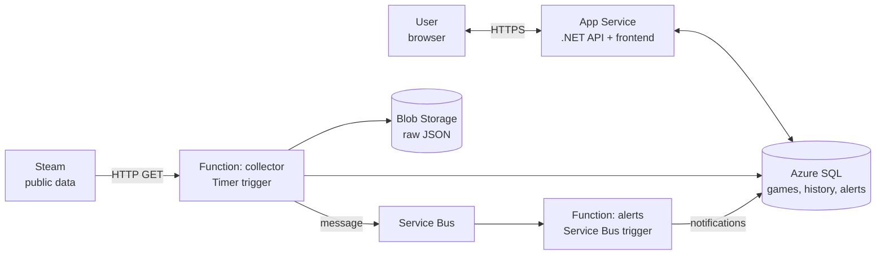

# GamePulse

A cloud platform for tracking video game prices and popularity, with personalized alerts.

## About

Game prices change often, and sales come and go quickly. GamePulse automatically and periodically collects the price and the number of active players for a list of about 50 games (public Steam data), keeps the history, and notifies users in the app when a game on their wishlist drops below their target price.

## Features

- **Sign-in** with a Microsoft account
- **Game catalog** with the current price, active discount and number of active players
- **Game page** with price and player history shown as a chart, plus the all-time low
- **Personal wishlist**
- **Price alerts**, for example "below 20 EUR" for a game on the wishlist
- **In-app notifications** when an alert is triggered

## Architecture

The collector function runs on a schedule, stores the raw response in Blob Storage and the history in SQL, then sends a message to Service Bus. The alerts function picks up the message, compares the new prices with the users' thresholds and writes the notifications, which the API then displays.

Shared across all components: VNet + NSG, Private Endpoints (SQL, Blob), Entra ID, Managed Identity, Key Vault, Application Insights.

## Azure services

| Area | Services |
| --- | --- |
| Compute | App Service, Azure Functions (Timer trigger, Service Bus trigger) |
| Storage | Blob Storage, Azure SQL Database |
| Messaging | Service Bus |
| Networking | Virtual Network, NSG, Private Endpoints, Private DNS |
| Security | Entra ID, Managed Identity, Key Vault |
| Observability | Application Insights, Azure Monitor |
| Deployment | Terraform, GitHub Actions |

## Example flow

1. The user signs in and adds a game to their wishlist, with a "below 20 EUR" alert.
2. The collector function fetches the prices and sees that the game is on sale for 14.99 EUR.
3. The alerts function compares the new price with the threshold and creates a notification.
4. The next time the user opens the app, they see the notification and the chart with the price history.
