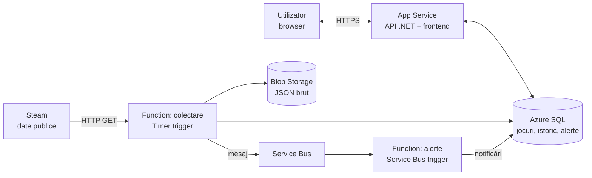

# GamePulse

Platformă cloud pentru monitorizarea prețurilor și popularității jocurilor video, cu alerte personalizate.

## Despre proiect

Prețurile jocurilor se schimbă des, iar reducerile apar și dispar repede. GamePulse colectează automat, periodic, prețul și numărul de jucători activi pentru o listă de aproximativ 50 de jocuri (date publice Steam), păstrează istoricul și anunță utilizatorul în aplicație când un joc din wishlist scade sub prețul dorit.

## Funcționalități

- **Autentificare** cu contul Microsoft
- **Catalog de jocuri** cu prețul curent, reducerea activă și numărul de jucători activi
- **Pagina jocului** cu istoricul prețului și al jucătorilor, afișat ca grafic, plus minimul istoric
- **Wishlist** personal
- **Alerte de preț**, de exemplu "sub 20 EUR" pentru un joc din wishlist
- **Notificări în aplicație** când o alertă este îndeplinită

## Arhitectura

Funcția de colectare rulează periodic, salvează răspunsul brut în Blob și istoricul în SQL, apoi pune un mesaj în Service Bus. Funcția de alerte preia mesajul, compară prețurile noi cu pragurile utilizatorilor și scrie notificările, pe care API-ul le afișează.

Comun tuturor componentelor: VNet + NSG, Private Endpoints (SQL, Blob), Entra ID, Managed Identity, Key Vault, Application Insights.

## Servicii Azure folosite

| Zonă | Servicii |
| --- | --- |
| Compute | App Service, Azure Functions (Timer trigger, Service Bus trigger) |
| Storage | Blob Storage, Azure SQL Database |
| Mesagerie | Service Bus |
| Networking | Virtual Network, NSG, Private Endpoints, Private DNS |
| Securitate | Entra ID, Managed Identity, Key Vault |
| Observabilitate | Application Insights, Azure Monitor |
| Deployment | Terraform, GitHub Actions |

## Exemplu de utilizare

1. Utilizatorul se loghează și adaugă un joc în wishlist, cu alerta "sub 20 EUR".
2. Funcția de colectare preia prețurile și vede că jocul a intrat la reducere, la 14,99 EUR.
3. Funcția de alerte compară prețul nou cu pragul și creează o notificare.
4. La următoarea deschidere a aplicației, utilizatorul vede notificarea și graficul cu istoricul prețului.
